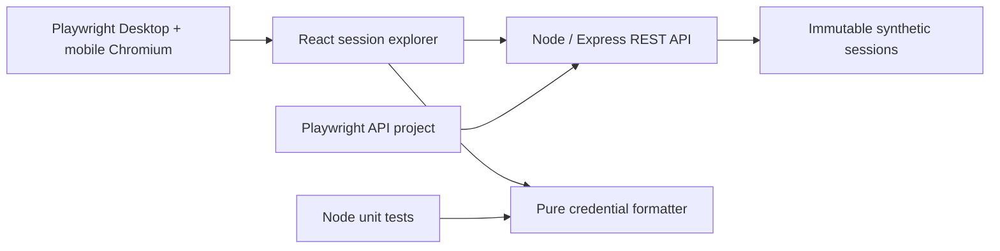
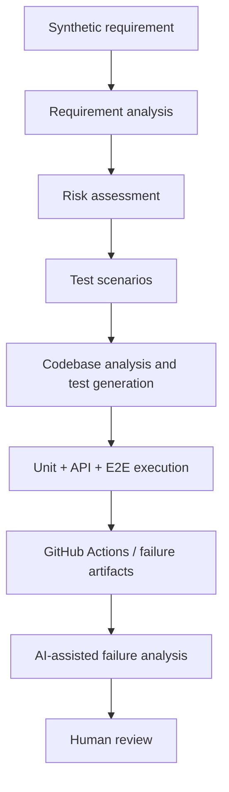
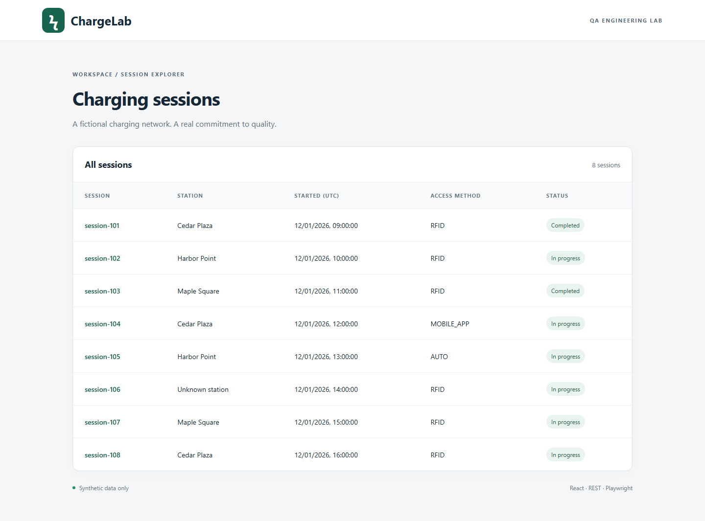

# AI-Augmented Playwright QA Lab

**ChargeLab** is a small fictional EV session explorer built to demonstrate QA engineering judgment: behavior-focused Playwright tests, TypeScript, REST contracts, privacy regression detection, parallel CI and critical review of AI-generated work.

> This repository is an independent fictional portfolio project created solely to demonstrate QA engineering and AI-assisted software development practices. All product requirements, application behavior, APIs, data models, test cases and architecture were created specifically for this project. It contains no proprietary source code, documentation, customer information, API specifications, test cases, internal architecture or confidential information from any current or previous employer.

## Run locally

Prerequisite: Node.js 22.12+ (Node 22 recommended) and npm. No accounts, environment secrets or database are required.

```bash
npm ci
npx playwright install chromium
npm run build
npm test
npm run dev
```

Open http://127.0.0.1:4173. Stop the dev server before testing a rebuilt production bundle. On Linux, use `npx playwright install --with-deps chromium` to include browser OS dependencies. `npm install` also works; `npm ci` reproduces the committed lockfile.

Tests automatically start the built application. Locally they may reuse a running server on port 4173; CI always starts its own. `npm run start` serves the built UI and API; `npm run dev` serves the same API with Vite middleware and hot reload.

## Architecture



- `src/domain.ts`: typed domain and pure presentation policy.
- `src/main.tsx`: semantic session table, details, loading/error states and navigation.
- `server/`: read-only API and eight invented session records.
- `tests/api/`: status, structure, associations, missing records and deliberate incomplete records.
- `tests/e2e/`: browser-visible behavior and real API integration.
- `tests/pages/` and `tests/fixtures/`: a focused page object composed into an isolated fixture.
- `tests/unit/`: low-cost edge cases for credential formatting.
- `ai/`: requirements, risks, traceable plan, failure investigation and review checklist.

### REST contract

| Route                 | Success                 | Missing resource                                                                   |
| --------------------- | ----------------------- | ---------------------------------------------------------------------------------- |
| GET /api/sessions     | 200 `{ "data": [...] }` | N/A                                                                                |
| GET /api/sessions/:id | 200 `{ "data": {...} }` | 404 `{ "error": { "code": "SESSION_NOT_FOUND", "message": "Session not found" } }` |

Responses are JSON with `Cache-Control: no-store`. Unknown API routes return JSON 404. The API intentionally contains raw **synthetic** IDs; the privacy requirement covers rendering, not network confidentiality. No authentication or persistence is implemented. It is a local demo, not a production security template.

### Product decisions

RFID details show trimmed alias or a four-character suffix mask. IDs of four or fewer characters are fully hidden. An alias containing the full ID also uses the mask. Revoked and unknown status are explicit. Non-RFID sessions omit the credential field even if data supplies one. Missing credential and station use safe fallback labels. All dates display UTC; an end timestamp determines Completed status. See [recorded assumptions](ai/requirement-analysis.md).

## Test workflow

```bash
npm run build
npm run test:unit
npm run test:api
npm run test:e2e
npm test -- --grep @privacy
npm test -- --shard=1/4
npm run report
npm run format:check
```

`npm test` runs the API, desktop and mobile Chromium projects. Unit tests are separate and required in CI. The suite uses fully parallel execution, isolated browser contexts, immutable server data, stable role/test-ID locators and web-first assertions. There are no sleeps, skipped scenarios or order dependencies. CI has two retries and two workers per shard; local runs have no retries. Traces are retained and screenshots captured on failure. Open trace attachments in the HTML report or use `npx playwright show-trace <trace.zip>`.

Privacy tests assert both the exact safe label and absence of the full identifier from the entire HTML, including attributes. A positive loaded-state check guards against a false pass on an empty page. Expected values are independent of application helpers and seed imports.

API tests cover cheap contract and association checks. Browser tests cover critical user journeys, masking and resilience. Unit tests handle string boundaries and defensive policy without multiplying E2E permutations. See [risk assessment](ai/risk-analysis.md) and [coverage mapping](ai/generated-test-plan.md).

## CI and sharding

[QA workflow](.github/workflows/qa.yml) first checks formatting, TypeScript/build and unit tests. Four matrix jobs install desktop and mobile Chromium, build, then execute `--shard=N/4`. Playwright starts the production server. Fully parallel mode distributes individual tests across shards. Every completed shard uploads a blob report, even after test failure; failed runs also preserve raw artifacts. A final job merges blobs into one downloadable HTML report. npm downloads are cached through setup-node; browser binaries are installed per job to avoid stale browser/dependency caches. Artifacts expire after 7 days (raw) or 14 days (HTML).

A failed test still fails its matrix job even when report generation succeeds. Missing artifacts or installation failures must be diagnosed from job logs; a merged report is not proof that every shard executed.

## AI-assisted QA



Start with the [workflow](ai/workflow.md), [feature request](ai/feature-request.md) and [human checklist](ai/human-review-checklist.md). AI is an engineering multiplier, not an authority. Generated selectors, assumptions and assertions require evidence. A plausible explanation is not a verified fix.

The [controlled regression walkthrough](ai/failure-analysis-example.md) changes masking to a raw identifier, shows the expected Playwright failure and explains why investigation should fix the product rather than weaken the test. No runtime defect flag is shipped.

## Engineering choices and limits

A single Node process serves UI and API, making local startup and CI deterministic. React and a small Express service avoid an unnecessary full-stack framework. Query-string navigation uses normal links with no router dependency. The pure formatter separates policy from rendering. One small page object encapsulates a repeated user operation; composition through fixtures avoids inheritance trees and artificial classes. Immutable data makes parallel reads safe without an unnecessary database or reset endpoint.

The API types document expected optional fields; this project does not validate arbitrary hostile JSON or implement all possible network failures. It has no write lifecycle, login, pagination or billing. Formatting is enforced with Prettier, TypeScript provides static checks; no separate lint tool is configured.

Next useful extensions: schema validation at API boundaries, keyboard/accessibility auditing, cross-browser coverage, uniquely isolated mutable test data and authenticated data-minimization tests. Add these in response to requirements rather than to inflate the tooling list.

Browser scope: the initial Windows Firefox runs failed before test execution with a native side-by-side / mozglue launch error, reproduced with two Playwright versions. The verified suite targets Chromium desktop and mobile emulation. It makes no Firefox or real-device coverage claim. Add Firefox in a compatible environment as a separate expansion.

## Preview and validation



See the [validation record](docs/validation.md) for executed checks, the controlled negative test and explicit coverage limits.
